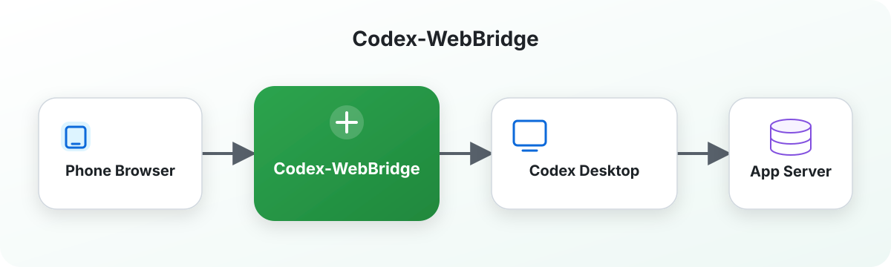
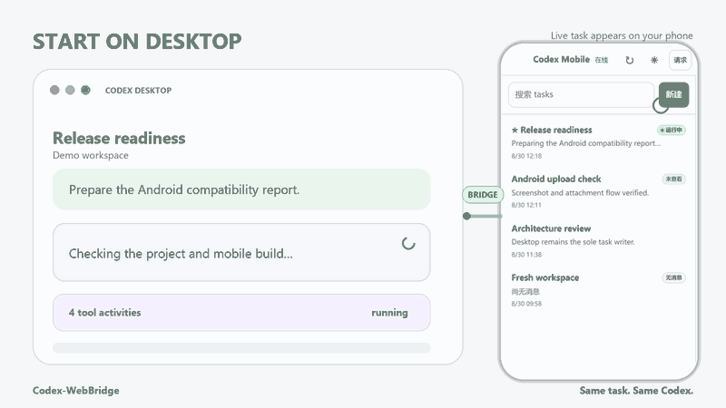
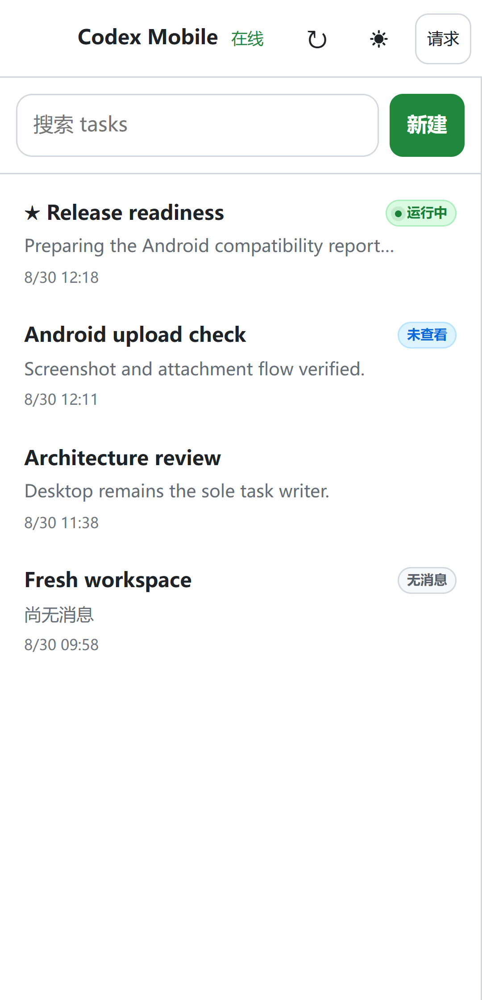
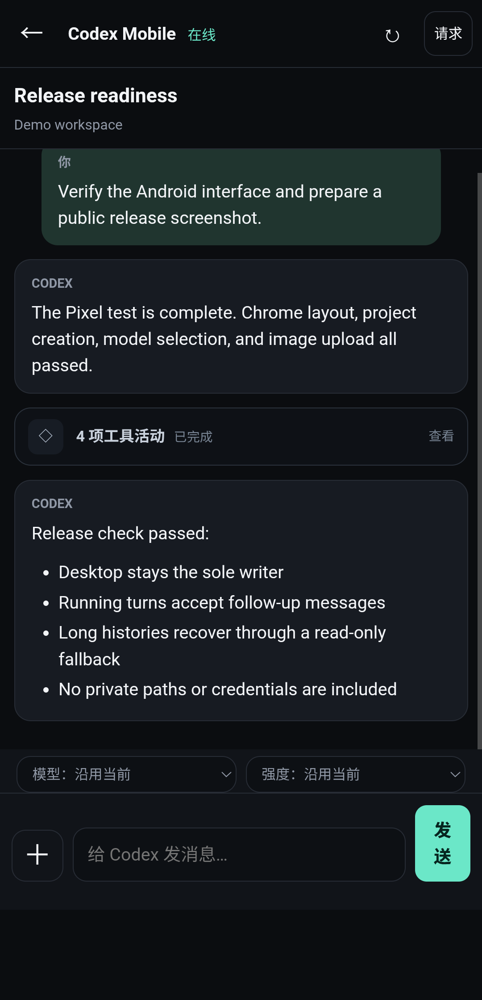

# Codex Mobile Web Bridge

English | [简体中文](README.zh-CN.md)

## Why this exists

Some phones or operating systems cannot use the official Codex mobile app. Some Codex setups use an API key on the computer, so there may be no OpenAI account to sign into on the phone. If Codex already works on your computer, Codex-WebBridge lets a phone browser reuse it without installing the official mobile app or signing in to OpenAI again on the phone.

Codex-WebBridge is an independent, unofficial project. It uses experimental Codex App Server messages, so a Codex update may require compatibility fixes.

## Compatibility

Verification scope differs by Codex version. A read-only check is not evidence that task writes or the complete mobile workflow work on that version.

| Check | Environment | Verified scope |
|---|---|---|
| End-to-end mobile baseline, August 2026 | Windows 11 25H2 x64; Codex Desktop `26.820.9563.0`; bundled CLI `0.150.0-alpha.8`; Chrome on Android (Pixel) and a Huawei HarmonyOS browser | Manual end-to-end mobile workflow |
| Read-only history compatibility, latest check | Codex Desktop `26.1117.4957.0`; bundled CLI `0.171.0-alpha.13` | Process-filtered endpoint discovery, `tools/list` handshake, session listing, and latest-turn reading. The read-only rollout-history restore path was not exercised. No task message was sent; full mobile workflow is unverified on this version. |

Other Codex Desktop versions should be checked before enabling writes. See the [Codex update checklist](docs/codex-update-checklist.md).

Windows Desktop-control is the verified live Desktop path. The macOS/Linux start scripts use the private stdio compatibility mode by default; they are not verified as live Desktop-control integrations.

## Architecture

Codex-WebBridge connects a phone browser to the existing Codex Desktop app. In Desktop-control mode, Desktop remains the only task writer.

## What works

- Fast task list with running, unread-complete, and empty states.
- Recent-history-first rendering and paginated older turns.
- Streaming replies and collapsed live tool previews.
- Running-turn append and soft stop requests. A soft stop is a message request, not a hard interrupt.
- Collapsed command, file-change, and tool activity previews.
- Authenticated image viewing and local artifact preview/download.
- Phone file upload and clipboard-image upload with progress and deduplication.
- Project discovery, task creation, and model selection through the Desktop connection.
- Standalone Markdown viewer for local files, pasted text, and authenticated task artifacts.
- Browser Back and edge-swipe navigation.
- System-following or manually selected light/dark themes.
- Loopback-only default binding and password authentication.

When Desktop omits recent items from a task read, the bridge can restore the missing history from local rollout files using a read-only fallback. It does not use those files to write to a task.

## Markdown viewer

Open **Markdown preview** from the task list or visit `markdown.html` under the same bridge URL. Markdown artifact cards open the preview in a new tab; their download action still returns the original file. The viewer also accepts local `.md`, `.markdown`, `.mdown`, and `.txt` files or pasted text, with preview/source views and light/dark themes. Local files and pasted text stay in the browser.

The viewer accepts documents up to 2 MiB. Task documents use the existing authenticated artifact endpoint; an expired or changed-file link must be reopened from the task. Raw HTML is shown as text. Relative local images and file links are not resolved. Rendering assets are served locally, without a CDN. See [the viewer notes](docs/markdown-viewer.md).

## Mobile preview

The screenshots below use the real mobile UI with a fully synthetic demo dataset. They contain no task transcript, local path, account, credential, or public endpoint.

<table>
  <tr>
    <td width="50%"></td>
    <td width="50%"></td>
  </tr>
  <tr>
    <td align="center"><strong>Task status at a glance</strong></td>
    <td align="center"><strong>Read, append, upload, and choose a model</strong></td>
  </tr>
</table>

Contributors can reproduce the synthetic UI locally with `npm run demo`. The demo server never connects to Codex and must not be used for real tasks.

## Requirements

- Node.js 22 or later.
- Codex installed and authenticated for the current operating-system user.
- A Codex version that provides `codex app-server --stdio` for the compatibility fallback.
- One free local port (`4780` by default) and a modern browser.

This repository does **not** include Codex binaries or credentials. The local bridge does not require a separate OpenAI API key beyond the user's existing Codex authentication, a database, VPS, domain name, TLS certificate, modified Codex Desktop, or public relay service.

For phone access, choose one level:

| Use case | Additional minimum |
|---|---|
| Same trusted Wi-Fi | Bind to the LAN interface and allow the port in the computer firewall. |
| Access from anywhere | Provide one authenticated HTTPS route to the loopback bridge. |
| Full desktop/mobile experience | Windows Codex Desktop running normally; the bridge uses its native `codex_app` tools pipe. |

See [minimum deployment requirements](docs/minimum-requirements.md) for commands, security boundaries, and experimental limits.

## Quick start

### Windows

    git clone https://github.com/SSK015/codex-mobile-web-bridge.git
    cd codex-mobile-web-bridge
    npm install
    .\scripts\start.ps1

### macOS or Linux

    git clone https://github.com/SSK015/codex-mobile-web-bridge.git
    cd codex-mobile-web-bridge
    npm install
    chmod +x scripts/start.sh
    ./scripts/start.sh

Open `http://127.0.0.1:4780`. The first start creates a random bridge password inside the private state directory printed by the script.

The only runtime package is the `ws` WebSocket implementation, retained for legacy App Server compatibility modes.

## Deploy with another coding agent

An agent can deploy this project, but it must treat the Codex process and task history as user-owned state. Give the agent this instruction:

> Deploy this repository by following `docs/agent-deployment.md`. On compatible Windows builds, prefer Desktop-control mode through the native `codex_app` tools pipe. Keep Codex Desktop as the sole writer. Do not copy, replace, patch, stop, or redistribute Codex binaries, and do not interrupt existing Codex tasks. Keep the bridge and App Server on loopback, create a fresh private state directory and password, run all checks, and report the access URL, connection mode, persistence method, and verification results. Do not expose the bridge directly to the public internet or enable the legacy RPC-multiplexer topology as a fallback.

The [agent deployment runbook](docs/agent-deployment.md) defines preflight checks, safe startup order, remote-access boundaries, acceptance tests, and the handoff report.

## Connection modes

### Desktop control - recommended experience

On compatible Windows builds, the bridge uses Desktop's native `codex_app` tools pipe. Desktop remains the sole task writer; the phone invokes approved Desktop operations for listing, reading, sending, running-turn append, project discovery, and task creation. Recent items omitted by `read_thread` can be recovered from local rollout files through a read-only fallback.

This path does not inject a `codex_app` transport into `config.toml` and does not start or share another Desktop App Server. [Desktop reconnection notes](docs/desktop-control-reconnect.md) describe endpoint discovery and safe recovery.

### Single-connection shared mode - legacy experiment

Codex may associate a task's active writer with the client transport connection. Merely opening two WebSockets to one App Server is therefore not enough. The repository retains an RPC multiplexer for protocol research, but current Desktop ownership behavior can reject or destabilize this setup. It is not the recommended deployment path.

Start the bridge with both the private upstream App Server and the Desktop-facing multiplexer endpoint:

    CODEX_MOBILE_APP_SERVER_URL=ws://127.0.0.1:4512 \
    CODEX_MOBILE_RPC_MUX_LISTEN_URL=ws://127.0.0.1:4513 \
    node server.mjs

Do not configure Codex Desktop to connect to this route in normal deployment. Any experiment must use idle disposable tasks, version-specific acceptance tests, and an immediate rollback to an ordinary Desktop-owned App Server.

See [shared mode](docs/shared-mode.md) and [architecture](docs/architecture.md).

### Private stdio - compatibility fallback

Without `CODEX_MOBILE_APP_SERVER_URL`, the bridge starts `codex app-server --stdio`. This is the smallest portable smoke-test mode, but it is a second independent Codex client rather than remote control of the desktop's live client. Same-task writes may conflict, desktop-started turns cannot be steered reliably, and live events may appear only after persistence.

## Phone access

Do not bind this server directly to a public interface. Keep it on loopback and use either:

1. A private overlay network with HTTPS; or
2. An HTTPS reverse proxy with authentication and rate limiting.

For a path-based reverse proxy, set:

    CODEX_MOBILE_SECURE_COOKIE=1
    CODEX_MOBILE_COOKIE_PATH=/codex-mobile/

See [deployment guidance](docs/deployment.md), the [Nginx example](examples/nginx.conf), and [security policy](SECURITY.md).

A VPS and domain are optional implementation choices, not minimum requirements.

## Configuration

All configuration uses environment variables. See [.env.example](.env.example). Important settings include:

| Variable | Purpose |
|---|---|
| `CODEX_MOBILE_CODEX_PATH` | Installed Codex executable. |
| `CODEX_MOBILE_APP_SERVER_URL` | Existing loopback App Server WebSocket. |
| `CODEX_MOBILE_RPC_MUX_LISTEN_URL` | Loopback endpoint used by Desktop in single-connection shared mode. |
| `CODEX_MOBILE_SECRET_FILE` | Bridge password file. |
| `CODEX_MOBILE_HOST` | Bind host; defaults to `127.0.0.1`. |
| `CODEX_MOBILE_PORT` | Bind port; defaults to `4780`. |
| `CODEX_MOBILE_COOKIE_PATH` | Cookie scope behind a path proxy. |
| `CODEX_MOBILE_SECURE_COOKIE` | Set to `1` behind HTTPS. |
| `CODEX_MOBILE_UPLOAD_ROOT` | Private local upload directory. |

## Privacy model

- Task data stays between the browser, bridge, and local Codex environment.
- The initial task response omits raw tool schemas and large tool output.
- Local file URLs are expiring authenticated tokens bound to file identity.
- Service workers are not currently used, so task content is not offline-cached.
- Uploads stay in the configured local state directory.

## Development

    npm run check
    npm test
    npm run release:check

The release check fails on tracked binaries, large files, private keys, common personal path patterns, public deployment hostnames, and real-looking task IDs.

## Project status and license

The project is an unofficial community release under the Apache License 2.0. See [LICENSE](LICENSE), [NOTICE](NOTICE.md), and [contribution guidelines](CONTRIBUTING.md).
