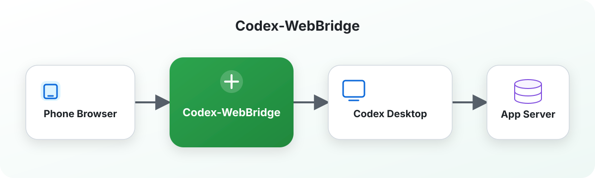
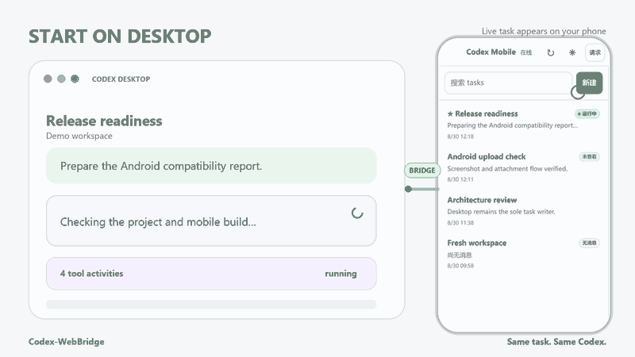
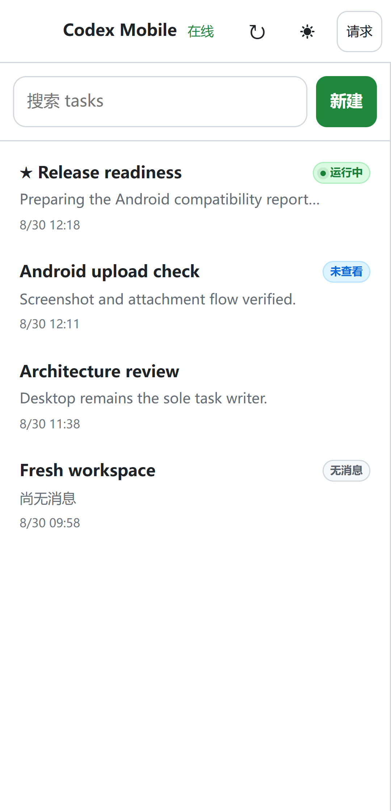
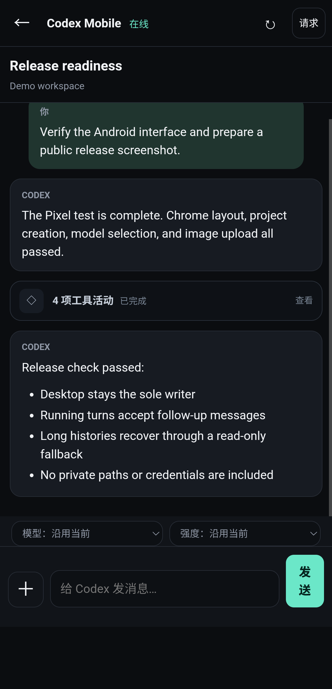

# Codex Mobile Web Bridge

[English](README.md) | 简体中文

## 为什么要做这个项目

有些手机或操作系统无法使用 Codex 官方手机 App；也有人在电脑上通过 API Key 使用 Codex，因此手机端没有可直接登录的 OpenAI 账号。只要电脑上的 Codex 已经能正常工作，Codex-WebBridge 就能让手机浏览器复用它，无需安装官方手机 App，也无需在手机上重新登录 OpenAI。

Codex-WebBridge 是独立的非官方项目。它使用实验性的 Codex App Server 消息，Codex 更新后可能需要进行兼容性修复。

## 兼容性

不同 Codex 版本的验证范围不同。只读检查不能证明该版本支持 task 写入或完整手机工作流。

| 检查 | 环境 | 已验证范围 |
|---|---|---|
| 2026 年 8 月端到端手机基线 | Windows 11 25H2 x64；Codex Desktop `26.820.9563.0`；内置 CLI `0.150.0-alpha.8`；Android 上的 Chrome（Pixel）及华为 HarmonyOS 浏览器 | 手动检查完整手机工作流 |
| 最新只读历史兼容性检查 | Codex Desktop `26.1117.4957.0`；内置 CLI `0.171.0-alpha.13` | 按进程归属过滤端点、完成 `tools/list` 握手、读取会话列表和最近一轮。只读 rollout 历史恢复路径未在本次检查中运行。未发送 task 消息；该版本尚未验证完整手机工作流。 |

其他 Codex Desktop 版本在启用写入前应先检查。请参阅 [Codex 更新检查清单](docs/codex-update-checklist.md)。

Windows Desktop 控制是已经验证的实时 Desktop 路径。macOS/Linux 启动脚本默认使用私有 stdio 兼容模式；尚未验证它们能够控制实时 Desktop。

## 架构

Codex-WebBridge 将手机浏览器连接到电脑上已运行的 Codex Desktop。Desktop 控制模式下，Desktop 始终是唯一的 task 写入者。

## 已实现功能

- 快速 task 列表，区分运行中、已完成但未查看和无消息状态。
- 优先渲染最近记录，并分页加载更早的 turn。
- 流式回复和默认折叠的实时工具预览。
- 向运行中的 turn 追加消息并请求软停止。软停止是消息请求，不是强制中断。
- 默认折叠的命令、文件修改和工具活动预览。
- 经过认证的图片查看，以及本地产物预览和下载。
- 手机文件上传和剪贴板图片上传，支持进度显示与去重。
- 通过 Desktop 连接发现项目、创建 task 并选择模型。
- 独立 Markdown 预览页，支持本地文件、粘贴文本和经过认证的 task 产物。
- 浏览器返回键和边缘左滑返回。
- 跟随系统或手动选择的明暗主题。
- 默认只监听 loopback，并使用密码认证。

当 Desktop 的 task 读取结果缺少最近记录时，Bridge 可以只读地从本地 rollout 文件恢复缺失历史，不会用这些文件写入 task。

## Markdown 预览

在 task 列表中选择「Markdown 预览」，或在相同的 Bridge 地址后打开 `markdown.html`。会话中的 Markdown 产物会在新标签页预览，下载操作仍返回原文件。预览页也支持本地 `.md`、`.markdown`、`.mdown`、`.txt` 文件及粘贴文本，并可切换预览／源码和明暗主题。本地文件与粘贴文本只在浏览器中处理。

文档上限为 2 MiB。task 文档使用已有的认证产物接口；链接过期或文件变化后，需要回到 task 重新打开。原始 HTML 按文本显示。本地相对图片和文件链接不会解析。渲染资源随应用提供，不依赖 CDN。详见 [Markdown 预览说明](docs/markdown-viewer.md)。

## 手机端预览

以下截图来自真实手机界面，但使用完全合成的 demo 数据。其中不包含 task 记录、本地路径、账号、凭据或公网地址。

<table>
  <tr>
    <td width="50%"></td>
    <td width="50%"></td>
  </tr>
  <tr>
    <td align="center"><strong>一眼查看 task 状态</strong></td>
    <td align="center"><strong>阅读、追加、上传附件并选择模型</strong></td>
  </tr>
</table>

贡献者可以运行 `npm run demo` 在本地复现合成界面。demo server 不会连接 Codex，也不能用于真实 task。

## 最低要求

- Node.js 22 或更高版本。
- 当前操作系统用户已安装并登录 Codex。
- 兼容性回退模式需要提供 `codex app-server --stdio` 的 Codex 版本。
- 一个空闲本地端口（默认 `4780`）和现代浏览器。

本仓库**不包含** Codex 二进制文件或凭据。除了用户已有的 Codex 登录状态外，本地 Bridge 不要求单独的 OpenAI API Key、数据库、VPS、域名、TLS 证书、修改过的 Codex Desktop 或公网中继服务。

手机访问可以选择以下级别：

| 使用场景 | 额外最低条件 |
|---|---|
| 同一个可信 Wi-Fi | 绑定到局域网接口，并在电脑防火墙中放行端口。 |
| 从任何地点访问 | 为 loopback Bridge 提供一条经过认证的 HTTPS 路由。 |
| 完整的桌面／手机体验 | Windows Codex Desktop 正常运行；Bridge 使用其原生 `codex_app` 工具管道。 |

准确命令、安全边界和实验性限制请参阅[最低部署要求](docs/minimum-requirements.md)。

## 快速开始

### Windows

    git clone https://github.com/SSK015/codex-mobile-web-bridge.git
    cd codex-mobile-web-bridge
    npm install
    .\scripts\start.ps1

### macOS 或 Linux

    git clone https://github.com/SSK015/codex-mobile-web-bridge.git
    cd codex-mobile-web-bridge
    npm install
    chmod +x scripts/start.sh
    ./scripts/start.sh

打开 `http://127.0.0.1:4780`。首次启动会在脚本显示的私有状态目录中生成随机 Bridge 密码。

唯一的运行时依赖是广泛使用的 `ws` WebSocket 实现，用于保留旧版 App Server 兼容模式。

## 让另一个 coding agent 部署

可以让 agent 部署本项目，但它必须把 Codex 进程和 task 历史视为用户拥有的状态。可以把下面这段指令交给 agent：

> 按照 `docs/agent-deployment.md` 部署本仓库。在兼容的 Windows 版本上，优先通过原生 `codex_app` 工具管道使用 Desktop 控制模式。保持 Codex Desktop 为唯一写入者。不要复制、替换、修改、停止或重新分发 Codex 二进制文件，也不要中断正在运行的 Codex task。让 Bridge 和 App Server 只监听 loopback，创建全新的私有状态目录和密码，运行所有检查，并报告访问 URL、连接模式、持久化方式和验证结果。不要把 Bridge 直接暴露到公网，也不要启用旧版 RPC multiplexer 拓扑作为回退。

[Agent 部署手册](docs/agent-deployment.md)定义了预检、安全启动顺序、远程访问边界、验收测试和交付报告。

## 连接模式

### Desktop 控制模式——推荐体验

在兼容的 Windows 版本上，Bridge 使用 Desktop 原生 `codex_app` 工具管道。Desktop 始终是唯一 task 写入者；手机可以调用 Desktop 提供的操作来列出和读取 task、发送消息、向运行中的 turn 追加消息、发现项目并创建 task。`read_thread` 遗漏的最近条目可以只读地从本地 rollout 文件恢复。

这条路径不会向 `config.toml` 注入 `codex_app` transport，也不会启动或共享另一个 Desktop App Server。[Desktop 重连说明](docs/desktop-control-reconnect.md)介绍端点发现和安全恢复。

### 单连接共享模式——旧版实验

Codex 可能会把 task 的 active writer 与客户端 transport 连接绑定。因此，仅为同一个 App Server 打开两个 WebSocket 并不足以共享写入权。仓库保留了 RPC multiplexer 用于协议研究，但当前 Desktop 所有权行为可能拒绝或破坏这种拓扑。它不是推荐部署路径。

同时指定私有上游 App Server 和面向 Desktop 的 multiplexer 端点来启动 Bridge：

    CODEX_MOBILE_APP_SERVER_URL=ws://127.0.0.1:4512 \
    CODEX_MOBILE_RPC_MUX_LISTEN_URL=ws://127.0.0.1:4513 \
    node server.mjs

正常部署时，不要让 Codex Desktop 连接到这条路由。实验必须使用空闲且可丢弃的 task，执行对应版本的验收测试，并能立即回滚到普通的 Desktop-owned App Server。

参阅[共享模式](docs/shared-mode.md)和[架构说明](docs/architecture.md)。

### 私有 stdio——兼容性回退

未设置 `CODEX_MOBILE_APP_SERVER_URL` 时，Bridge 会启动 `codex app-server --stdio`。这是最小、可移植的冒烟测试模式，但它是第二个独立 Codex 客户端，不是对 Desktop 实时客户端的远程控制。同一个 task 的写入可能冲突；Desktop 启动的 turn 无法可靠 steer；实时事件也可能要等持久化后才出现。

## 手机访问

不要把此服务直接绑定到公网接口。应保持 loopback 监听，并选择以下一种方式：

1. 提供 HTTPS 的私有 overlay 网络；或
2. 使用带认证和速率限制的 HTTPS 反向代理。

基于路径的反向代理需要设置：

    CODEX_MOBILE_SECURE_COOKIE=1
    CODEX_MOBILE_COOKIE_PATH=/codex-mobile/

参阅[部署指南](docs/deployment.md)、[Nginx 示例](examples/nginx.conf)和[安全策略](SECURITY.md)。

VPS 和域名是可选的实现方式，不是最低要求。

## 配置

所有配置均使用环境变量，参阅 [.env.example](.env.example)。重要设置包括：

| 变量 | 用途 |
|---|---|
| `CODEX_MOBILE_CODEX_PATH` | 已安装的 Codex 可执行文件。 |
| `CODEX_MOBILE_APP_SERVER_URL` | 已存在的 loopback App Server WebSocket。 |
| `CODEX_MOBILE_RPC_MUX_LISTEN_URL` | 单连接共享模式中供 Desktop 使用的 loopback 端点。 |
| `CODEX_MOBILE_SECRET_FILE` | Bridge 密码文件。 |
| `CODEX_MOBILE_HOST` | 监听地址，默认为 `127.0.0.1`。 |
| `CODEX_MOBILE_PORT` | 监听端口，默认为 `4780`。 |
| `CODEX_MOBILE_COOKIE_PATH` | 路径反向代理后的 Cookie 作用域。 |
| `CODEX_MOBILE_SECURE_COOKIE` | HTTPS 下设为 `1`。 |
| `CODEX_MOBILE_UPLOAD_ROOT` | 私有本地上传目录。 |

## 隐私模型

- Task 数据只在浏览器、Bridge 和本地 Codex 环境之间流动。
- 首次 task 响应会省略原始工具 schema 和大段工具输出。
- 本地文件 URL 使用有时效的认证 token，并绑定到文件身份。
- 当前不使用 Service Worker，因此不会离线缓存 task 内容。
- 上传内容保存在配置的本地状态目录中。

## 开发

    npm run check
    npm test
    npm run release:check

Release check 会阻止提交二进制文件、过大文件、私钥、常见个人路径、公网部署主机名以及看起来像真实 task ID 的内容。

## 项目状态与许可证

本项目是采用 Apache License 2.0 的非官方社区项目。参阅 [LICENSE](LICENSE)、[NOTICE](NOTICE.md) 和[贡献指南](CONTRIBUTING.zh-CN.md)。
